<h1 align="center">
  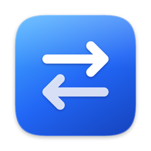<br>
  FileShare
</h1>

<p align="center">
  <b>English</b> · <a href="README.pt-BR.md">Português</a>
</p>

<p align="center">
  Copy on your Mac, paste on your Android tablet. And back.<br>
  Text, images and files over your own Wi-Fi, end-to-end encrypted. No account, no cloud.
</p>

<p align="center">
  <a href="https://marcofilho1.github.io/fileshare/"><b>Website</b></a> ·
  <a href="#install"><b>Install</b></a> ·
  <a href="#features"><b>Features</b></a> ·
  <a href="#faq"><b>FAQ</b></a> ·
  <a href="LICENSE"><b>MIT license</b></a>
</p>

<p align="center">
  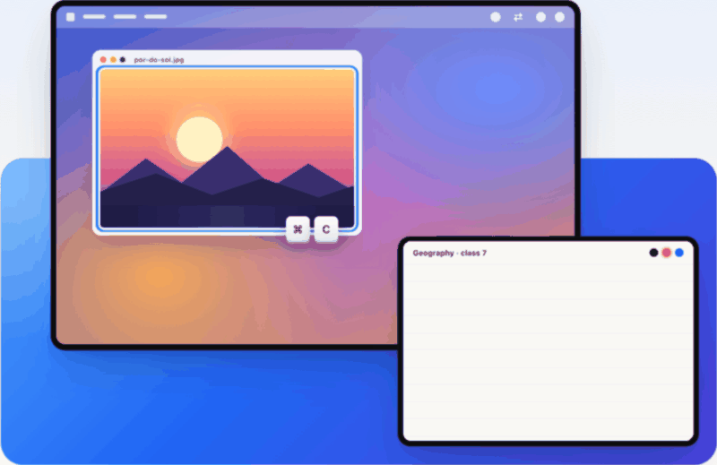
</p>

> [!TIP]
> **Like it, or did it help you?** ⭐ [Star the repository](https://github.com/MarcoFilho1/fileshare): it's what helps other people find FileShare.

## Why

Phone Link makes a Windows PC and an Android device feel like one: copy on one, paste on the other. Between a Mac and Android there was nothing like it, so every screenshot, link or PDF meant emailing yourself, a messaging app or a cable.

FileShare fills that gap. The Mac and the tablet share one clipboard: copy a photo on the Mac and paste it straight into Samsung Notes to write on it with the S Pen; copy a passage of your notes on the tablet and press ⌘V on the Mac. Files go both ways too, with one tap or one drag. Everything travels directly between the two devices over your Wi-Fi, encrypted, and never through a server.

It was built for, and tested with, a MacBook Air (macOS 26) and a Galaxy Tab S9 FE (Android 16 / One UI 8.5).

## Install

### 1. On the Mac

<p>
  <a href="https://github.com/MarcoFilho1/fileshare/releases/latest/download/FileShare.dmg"><b>⬇ Download FileShare.dmg</b></a> · macOS 14 or later
</p>

> [!IMPORTANT]
> **The first time you open it, macOS will block FileShare. That's expected.**
>
> 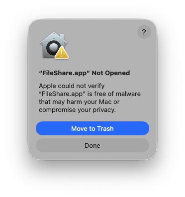
>
> FileShare is free and isn't notarized by Apple yet (a paid program), so macOS shows this notice. To open it:
>
> 1. Open `FileShare.dmg` and drag FileShare to **Applications**, then open it.
> 2. On this notice, click **Done**, the bottom button. **Don't** click *Move to Trash*, the blue button above it.
> 3. Open **System Settings → Privacy & Security**, scroll to **Security** and click **Open Anyway**. Confirm with your password or Touch ID.
>
>    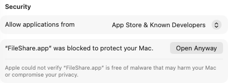
>
> That's it: from then on it opens normally. The code is open, so you can check all of it in this repository.

The app lives in the menu bar (the ⇄ icon) and opens showing a QR code to pair your tablet.

### 2. On the tablet

<p>
  <a href="https://github.com/MarcoFilho1/fileshare/releases/latest/download/FileShare.apk"><b>⬇ Download FileShare.apk</b></a> · Android 13 or later
</p>

The easiest way: **scan the Mac's QR code with the tablet's camera** and tap the link. If FileShare is already installed, the page opens it and pairs; if not, it shows how to download it, and after installing you just go back and tap **Connect**, with no need to scan again. When installing, Android asks you to allow apps from this source (only the first time).

<p align="center">
  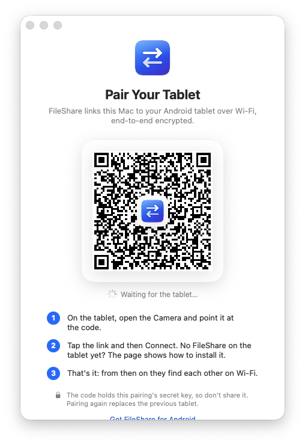
</p>

### 3. Set it up on the tablet

The tablet app shows the connection live and a short list of what's worth turning on, each with a button that takes you to the right setting: notifications, unrestricted battery (so the tablet doesn't cut the connection while asleep), the **Send to Mac** button in Quick Settings and the **accessibility permission** for automatic copy.

<p align="center">
  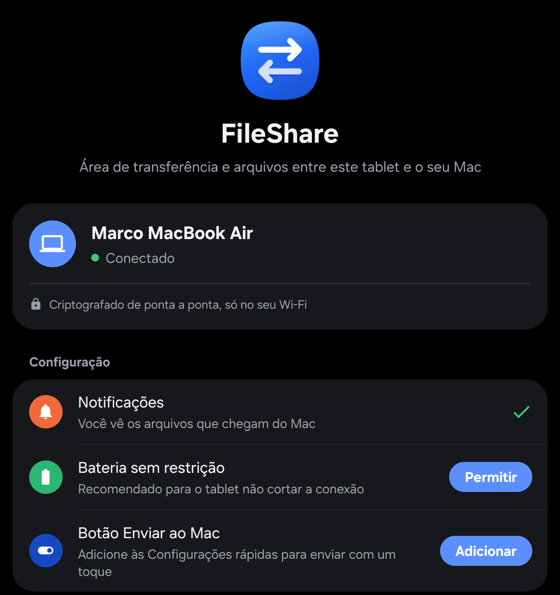
  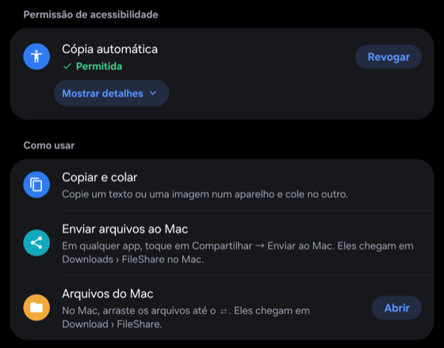
</p>

> [!NOTE]
> **Why accessibility?** Only for automatic copy: Android only tells an app that you tapped *Copy* through an accessibility service. FileShare only receives the name of the tapped button and system notices like "Copied"; it can't read the screen or what you type. It's optional: without it, use the Send to Mac button. The card explains this and lets you revoke it at any time.

## Features

### One clipboard for both

Copy text or an image on one device and paste it on the other, with no button and no app to open. Mac screenshots (⌘⇧4) included. Copies from password managers are ignored on purpose.

<p align="center">
  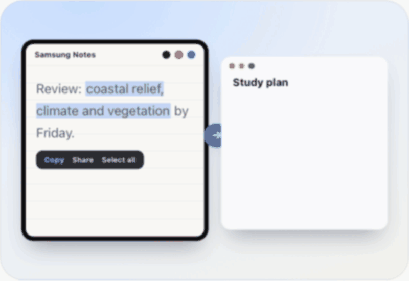
</p>

### Drag a file to ⇄

As a dragged file gets close to the menu bar icon, the **Send to Tablet** panel grows out of it, in the same glass as Control Center. Let go and the file goes to the tablet, with progress and a confirmation. You can also use the ⇄ panel (**Send File…**) or the Finder (right-click → **Quick Actions** or **Services** → **Send to tablet**).

<p align="center">
  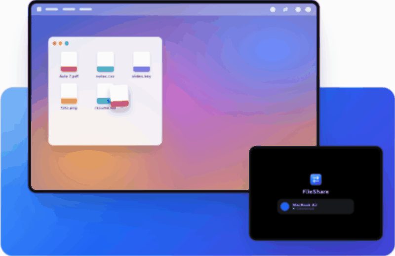
</p>

### Export a PDF straight to the Mac

In Samsung Notes (or any app), tap **⋮ → Share** and pick your Mac in the top row, right where Phone Link's "Link to Windows" shows up. The file lands in **Downloads › FileShare** and the Mac shows a notice; click it to open.

<p align="center">
  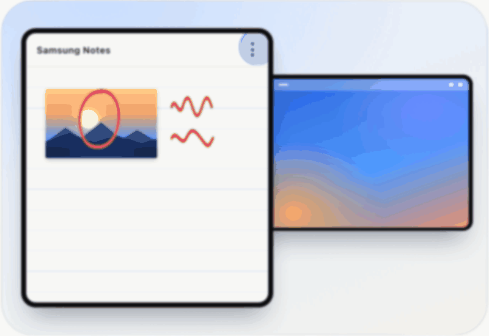
</p>

### A panel that feels like part of macOS

Click ⇄ for a panel in the manner of Control Center: the tablet, its connection and battery, round toggles for **Sync** (pause) and **Open at Login**, recent activity with file progress, and shortcuts to send a file or open what you received.

<p align="center">
  <picture>
    <source media="(prefers-color-scheme: dark)" srcset="docs/media/mac-panel-dark.png">
    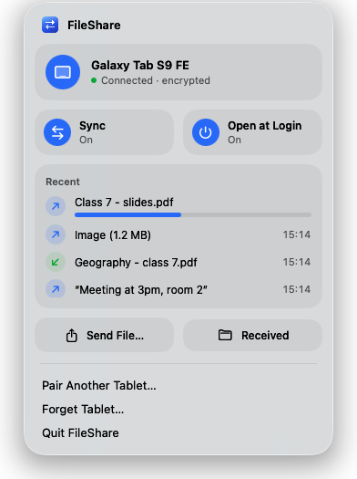
  </picture>
  <picture>
    <source media="(prefers-color-scheme: dark)" srcset="docs/media/send-to-tablet-dark.png">
    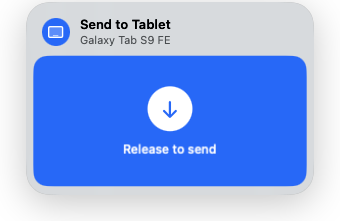
  </picture>
</p>

### Out of reach? It waits

Both ways. The Mac keeps your last copy for up to 10 minutes and files wait in a queue until the tablet wakes. The tablet does the same when the Mac is away: your last copy waits 10 minutes and shared files wait up to 24 hours, with a **Waiting for the Mac** notice and a **Cancel** button. As soon as they find each other on the network again (within seconds), everything is delivered; if you copied something newer in the meantime, your newer copy stays. Both apps start on their own: the Mac app at login, the tablet service after a restart or an update.

## FAQ

**Does it need the internet?** No, but it needs Wi-Fi: the Mac and the tablet have to be on the **same network**. What you copy goes straight from one to the other through the router and never travels over the internet, so it works even if the internet is down, as long as the router is on.

**Does it work away from home?** On any network they're both on, like your office's. Some public networks (hotels, campuses, airports) block devices from talking to each other.

**Where do received files go?** On the Mac, `Downloads/FileShare`; on the tablet, `Download/FileShare`. Up to 100 MB per file.

**Can someone on the same network see what I copy?** No. Everything is encrypted with a key only your two devices have, created when you pair. Without that key a device is refused, and unpaired, the Mac doesn't even show up on the network.

**Does it work with other Android devices?** It should on Android 13 or later, but it was tested on a Galaxy Tab S9 FE. On other brands, automatic copy may not recognize the Copy button; Send to Mac and Share work everywhere.

**iPhone, iPad or Windows?** Not for now: it's Mac with Android.

More answers on the [website](https://marcofilho1.github.io/fileshare/#perguntas).

## Battery

macOS doesn't tell apps when something is copied (Windows and Android do). So FileShare on the Mac, like every Mac clipboard manager (Maccy, Raycast, Paste…), checks a system **counter** that changes with each copy every 0.5 s. It's reading a single number; the content is only read when the counter changes, that is, when you copied something.

That check has 0.2 s of **leeway**: macOS can delay it slightly to run it when the processor is already awake for another reason (clock, network, other apps). Most of the time FileShare rides along on those wake-ups instead of waking the processor just for itself, and a copy is still noticed within 0.7 s.

Between the devices there's no polling: the connection stays open and each side sends a copy the moment it happens. The only periodic traffic is a small signal from the tablet every 20 s to check the connection is alive.

## Security

- The QR code carries a 32-byte secret key, kept in the Mac's Keychain and encrypted by the Android Keystore on the tablet.
- Each connection derives fresh keys (HKDF-SHA256 with nonces from both sides) and encrypts everything with ChaCha20-Poly1305; replayed or tampered messages are refused.
- Unpaired, the Mac doesn't appear on the network; paired, it announces itself with a generic name and only answers devices that prove they have the key.
- The QR is a link to the website with the key after the `#`, a part browsers never send to a server; the page removes it from the address bar right away and loads nothing from elsewhere.

## Build from source

Requirements (macOS):

```sh
brew install android-platform-tools openjdk@17 android-commandlinetools
sdkmanager "platforms;android-36" "build-tools;36.0.0"
```

**Android** (enable USB debugging on the tablet and plug it in to install):

```sh
cd android
echo "sdk.dir=$(brew --prefix)/share/android-commandlinetools" > local.properties
JAVA_HOME=$(brew --prefix openjdk@17)/libexec/openjdk.jdk/Contents/Home ./gradlew installDebug
```

**Mac** (Swift Package, no Xcode needed):

```sh
cd mac/FileShare
scripts/build-app.sh       # builds build/FileShare.app
scripts/install.sh         # installs it to /Applications and opens it
scripts/test.sh            # tests (works with just the Command Line Tools)
```

**Release files:** `scripts/package.sh` builds `dist/FileShare.dmg` and `dist/FileShare.apk`, signing the APK with the release key kept outside the repository. Without that key, builds use Android's debug key.

```
android/   Android app (Java): connection service, clipboard, share target, Quick Settings tile
mac/       menu bar app (Swift Package): connection, clipboard, panels, pairing
site/      the website (GitHub Pages), published by the Site workflow
scripts/   release packaging
tools/     development helpers
docs/      plan, test results and the README's media
```

**Contributing:** `main` only gets stable releases; work happens on `feature/*` branches off `develop`, with a reviewed pull request. Issues and ideas are welcome.

## License

[MIT](LICENSE)

<p align="center">
  If FileShare helped you, ⭐ <a href="https://github.com/MarcoFilho1/fileshare"><b>star the repository</b></a>. Thank you!
</p>
